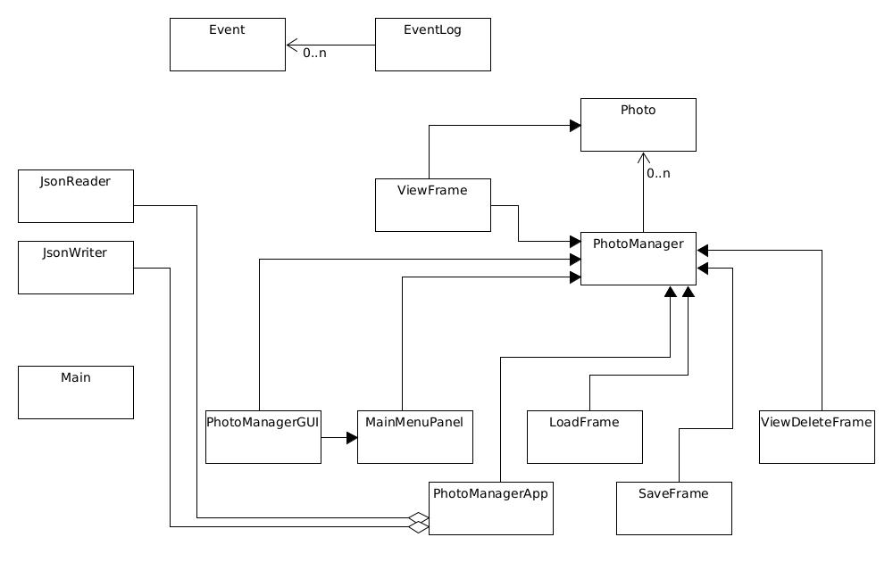

# Photographer's Dream
This application aims to improve and speed up a 
photographer's workflow post-shoot.

## Project Proposal/Motivation

This project seeks to solve a problem that many photographers face post-shoot.
A typical workflow of a photographer consists of taking photos and 
sifting through hundreds upon hundreds of photos, some organize them 
by giving a photo rating, or description, or some may outright delete them.
This project seeks to smooth out this process down to ***one*** keystroke.

## Who is this for? 
- This project is coded by a Photographer for Photographers.


## Use cases (User Story)
<!-- > User want to quickly give ratings out of 5.
  - the application can accomidate by showing the photos, and if the 
  user press 1, rating of 1 will be applied, if 2, rating of 2 will be 
  applied so on and so on... 
  - The application will be able to sort over a list of *rated* photos.

> User want to quickly delete photos.
  - the application can accomidate by automatically going through a 
  series of photo in a directory and user will be able to delete 
  the photo with one click. And the application **won't** actually delete them,
  but it will store the list of "deleted" photos in the bakground
  so the user could retrieve the file if a miss press happened. -->

> As a user, I want to add a Photo to my PhotoManager.

> As a user, I want to see all the photos in my PhotoManager

> As a user, I want to give ratings to my photos

> As a user, I want to know which photos are trash and need to be deleted.

> As a user, I want to have the option to save my photo'ss metadata to file

> As a user, I want to have the option to load my photo's metadata 
from a file.

# Instructions for End User

## How to add Photos
1. Press "Add Photo".
2. Select File 
3. Press Open

## How to View All the Photos 
1. Press "View Photos"
2. Press next as you are ready to look at the next photo.

## How to Tag a Photo as Delete
1. Press "View Photos" 
2. On the left hand side, select "Yes" if you want this photo to be deleted.

## How to view the "To be Deleted" Photos
1. Press "Show To Delete Photos" 
2. Press "Next" to cycle through all the to be deleted photos.

## How to give a Photo Rating 
1. Press "View Photos" 
2. On the buttom, select the rating in the Combo Box.

## How to Save the state of the Program
1. On the main menu press "Save Data" 
2. On the popup box, enter a name you will remember later.

## How to Load a previous state of the Program
1. On the main menu press "Load Data" 
2. Enter the name of the state.


# Phase 4: Task 2
Sample Output: 
```
Mon Mar 24 17:22:31 PDT 2025:A new photo with path: /home/tzen/cpsc210/ProjectStarter/photos/IMG_1672.JPG was added
Mon Mar 24 17:22:33 PDT 2025:A new photo with path: /home/tzen/cpsc210/ProjectStarter/photos/IMG_1778.JPG was added
Mon Mar 24 17:22:34 PDT 2025:A new photo with path: /home/tzen/cpsc210/ProjectStarter/photos/IMG_2221.JPG was added
Mon Mar 24 17:22:42 PDT 2025:Photo with path: /home/tzen/cpsc210/ProjectStarter/photos/IMG_1672.JPG was tagged to be Deleted
Mon Mar 24 17:22:48 PDT 2025:Photo with path: /home/tzen/cpsc210/ProjectStarter/photos/IMG_1778.JPG was given a rating of 3
Mon Mar 24 17:22:53 PDT 2025:Photo with path: /home/tzen/cpsc210/ProjectStarter/photos/IMG_2221.JPG was tagged to be Deleted
Mon Mar 24 17:22:54 PDT 2025:Photo with path: /home/tzen/cpsc210/ProjectStarter/photos/IMG_2221.JPG was given a rating of 5
Mon Mar 24 17:23:18 PDT 2025:Photo with path: /home/tzen/cpsc210/ProjectStarter/photos/IMG_1672.JPG was tagged to be Deleted
Mon Mar 24 17:23:18 PDT 2025:Photo with path: /home/tzen/cpsc210/ProjectStarter/photos/IMG_1672.JPG was given a rating of -1
Mon Mar 24 17:23:18 PDT 2025:A new photo with path: /home/tzen/cpsc210/ProjectStarter/photos/IMG_1672.JPG was added
Mon Mar 24 17:23:18 PDT 2025:Photo with path: /home/tzen/cpsc210/ProjectStarter/photos/IMG_1778.JPG was given a rating of 3
Mon Mar 24 17:23:18 PDT 2025:A new photo with path: /home/tzen/cpsc210/ProjectStarter/photos/IMG_1778.JPG was added
Mon Mar 24 17:23:18 PDT 2025:Photo with path: /home/tzen/cpsc210/ProjectStarter/photos/IMG_2221.JPG was tagged to be Deleted
Mon Mar 24 17:23:18 PDT 2025:Photo with path: /home/tzen/cpsc210/ProjectStarter/photos/IMG_2221.JPG was given a rating of 5
Mon Mar 24 17:23:18 PDT 2025:A new photo with path: /home/tzen/cpsc210/ProjectStarter/photos/IMG_2221.JPG was added
```

# Phase 4: Task 3 


## Potenial Improvements and Trade Offs
### First Change
After reflection upon the UML Diagram, 
one potenial improvement/refactoring that could be done is 
abstracting `ViewFrame` and `ViewDeleteFrame` into a general `PhotoFrame`.
This is because they both render photos,
with both iterating over a list, fetching photo path, and 
creating a `JLabel` image. In other words, they 
only differ in the collection that they iterate over.
So an abstraction here is the ideal canditate. 
Hence, one of the ways that the refactoring 
could be done is:

```java
public abstract class PhotoFrame extends JFrame {

    public PhotoFrame(List<Photo> photos);

}
```
where an abstarct class called `PhotoFrame` is created, that takes
the list of photos to iterate over. 

Something similar could be said for `LoadFrame` and `SaveFrame`. 
Both provide a text box for user to enter in the desire path, and 
performs *some* action. 

A potential fix: 
```java
public abstract class SerializeFrame extends JFrame {

    public SerializeFrame(String action);

}
```

where if `action` is `"w"` it calls `JsonWriter`, and `JsonReader` 
if it's `"r"` instead.

### Second Change

Finally, the field for the `Photo` class in `ViewFrame` could 
be removed, for a cleaner and clearer code association. 

Currently, the field is used to hold the current photo that the 
Viewer is displaying. This could easily be changed into a `String` 
type, where it holds the path to `Photo` instance. And everytime 
the instance is needed, `PhotoManager.getPhoto(curPhotoPath)` could
be called. Therefore reducing complexity in association. 


## Third Change
With many classes needing to "observe" `PhotoManager`, 
the observer design pattern could be applied here. 
This would elimate many duplication in the code, where 
`PhotoManager` has to be copied/passed around the code. 

Steps for this refactor: 
1. Create an abstract class called `Observable` 
2. Have `PhotoManager` extend `Observable` 
3. Create an interface called `Observer` with an `void update()` method. 
4. Have all the class that contains a field of `PhotoManager` 
implement this interface. 
5. In `PhotoManager` whenever `this` is modified, notifiy all observer.
Elimating the need of the field.

